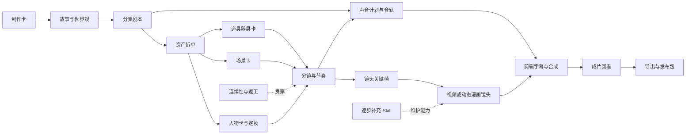

# Dear Deer 短漫剧创作工作台

这是可复制到创作项目的工作台模板。由 Codex 根据已有材料补填，用户只需逐次决定关键选择。模板中的能力登记不是制作完成证明。

## 本次制作

- 作品名称与目录：待确定。
- 原始材料与确认版本：待登记。
- 主角、目标与核心冲突：待整理。
- 表现形式、参考风格、画幅与语言：待确定。
- 全剧集数、单集时长与本次范围：沿用用户规格；未提供时提出试做建议。
- 可用工具与生成授权：按本次请求登记；搭流程阶段只做文字准备。
- 当前环节：N00。
- 当前只需用户决定的一件事：根据实际材料填写。
- 若选用 Toonflow：登记服务器项目绑定、剧本节点与最近 revision、空间手册入口及本设备只读验收；参考 toonflowBridge。未选用则不创建这类绑定。

## 环节关系

连线说明制作依赖。可先做分镜草案和资产文字卡，正式镜头生成再使用已选定母版。

## 工作节点

每行是可单独继续的环节。需展开时，用节点卡记录输入版本、结果路径、通过标准和下一步。

| 节点 | 用途与依赖输入 | 可交接产物 | 已有能力／专用 Skill | 待补能力 | 制作状态 |
|---|---|---|---|---|---|
| N00 制作卡 | 创意与用户要求；明确这次范围 | 制作卡、试做范围 | 总工作台／Codex | 按需要完善项目策划 | 待开始 |
| N01 故事与世界观 | N00；故事因果、规则、人物关系 | 大纲、关系、规则、伏笔 | Codex 文字创作 | 专用编剧 Skill | 待开始 |
| N02 分集剧本 | N01；把单集写成可演动作与对白 | EP 场次表与正文 | Codex 文字创作 | 分集编剧与时长打磨 Skill | 待开始 |
| N03 资产拆单 | N02；识别可见资产及复用状态 | CHAR／LOC／PROP 清单 | 总工作台模板 | 按实际漏项补拆单规则 | 待开始 |
| N04 人物卡与定妆 | N03；身份、外观、服装与拓扑 | 人物卡、母版与变体 | imagegen；文字卡先行 | 专项角色一致性能力 | 待开始 |
| N05 场景卡 | N03；空间布局、机位与光源 | 地点卡、方向与状态参考 | imagegen；文字卡先行 | 专项空间一致性能力 | 待开始 |
| N06 道具器具卡 | N03；形状、功能、持握与状态 | 物件卡、参考与变体 | imagegen；文字卡先行 | 特殊机械与交互能力 | 待开始 |
| N07 分镜与节奏 | N02、N04—N06；镜头动作与时间线 | 分镜表、朗读／预演 | Codex 文字计划 | 专用分镜 Skill | 待开始 |
| N08 镜头关键帧 | N07、已选资产；让构图支持动作 | 起止画面、提示词与引用 | imagegen | 按样片缺陷补镜头约束 | 待开始 |
| N09 镜头制作 | N08；按表现形式制作动态画面 | 逐镜视频或动态漫画素材 | Remotion；选用 MiniMovie 时发现无声／原生有声图生视频 MCP | 其他环境核对实际视频工具；逐镜质量验收 | 待开始 |
| N10 配音音乐音效 | N02、N07；声音支持对白与动作 | 声音卡、对白表、音轨 | Codex 声音计划；已有音轨；MiniMovie 原生声音或后期离线配音 | 通用角色 TTS／音效及当前镜头试听 | 待开始 |
| N11 剪辑字幕合成 | N09、N10；按时间线组成作品 | 粗剪、字幕、混音、精剪 | Remotion；MiniMovie 五秒后期合成 | 多镜头自动剪辑和具体声音保留方案 | 待开始 |
| N12 成片检查 | N11 可播放精剪；实际回看 | 带时间点的问题与修复单 | 总工作台回看方法 | 以实际工具核验视听检查 | 待开始 |
| N13 导出与发布包 | N12；交付可播放文件与介绍 | 视频、字幕备份、封面简介 | Remotion 导出；imagegen 封面 | 指定渠道交付规则 | 待开始 |
| N14 连续性与返工 | 各环节版本与变更 | 锁定表、引用与返工记录 | 总工作台记录 | 实际故障驱动的专项 Skill | 待开始 |
| N15 Skill 补全 | 当前最先阻塞的环节 | 新能力合同、Skill 与试跑结果 | skill-creator | 按项目需求逐步补充 | 待开始 |

## 单节点展开卡

编号与用途；依赖与输入版本；本次交付物；实际工具／Skill；能力状态；制作状态；通过标准；结果路径与选择记录；下一步。

能力状态使用待补、已发现待核验、定义已核验可接入、已绑定、已试跑通过。制作状态使用待开始、准备中、待用户选择、可进入下一环节、需返工、完成、阻塞。

## 已选资产与改稿

| 编号 | 类型与名称 | 当前选定版本／状态 | 结果路径 | 使用它的镜头 | 变更影响 |
|---|---|---|---|---|---|

候选图先登记为候选；用户选择后再写为当前母版。用一次真实制作补齐记录，保留可以复用的素材。

## 下一步

写出当前能推进的动作和唯一必要选择。用户说“继续 Nxx”时先恢复相关材料，不重新询问已有决定。

## 可选网页与角色探索

网页输出目录／入口；所用清单版本；文件映射与来源；等待添加项；已选实际文件版本；浏览器清单导出；本轮批次；启动检查未决项。

CG角色专用Skill：dear-deer-cg-character-assets；CHAR编号与角色设计记录；当前轮次；五方向；各轮用户选择／委托；全身母版与身份近景；派生图和检查状态。未启动此模式就写不适用，不自动三维化。
